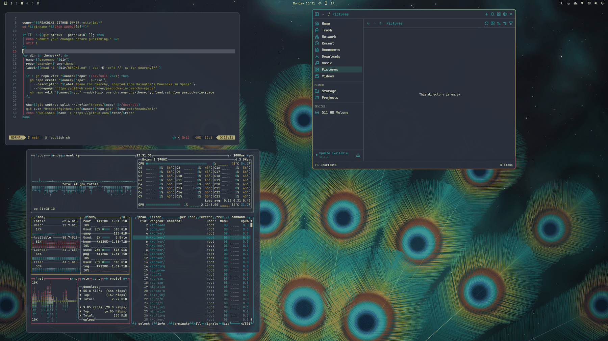

# Peacocks in Omarchy Space

Omarchy 4 themes based on [Rainglow](https://github.com/rainglow/vscode)'s Peacocks in Space:

| Theme | Base | Repository |
| --- | --- | --- |
| Peacocks In Space | Dark, editor slate `#2b303b` | [omarchy-peacocks-in-space-theme](https://github.com/ottojimb/omarchy-peacocks-in-space-theme) |
| Peacocks In Space Contrast | Near black `#121419` | [omarchy-peacocks-in-space-contrast-theme](https://github.com/ottojimb/omarchy-peacocks-in-space-contrast-theme) |
| Peacocks In Space Light | Light `#dee3ec` | [omarchy-peacocks-in-space-light-theme](https://github.com/ottojimb/omarchy-peacocks-in-space-light-theme) |



## Install

Full install, all three variants:

```bash
git clone https://github.com/ottojimb/peacocks-in-omarchy-space
cd peacocks-in-omarchy-space && ./install.sh
omarchy-theme-set peacocks-in-space
```

`install.sh` symlinks each theme into `~/.config/omarchy/themes`. Omarchy honours Lua files,
terminal configs and `vscode.json` only for symlinked themes, so only this install gets the
blur, the translucent terminal, Rainglow's syntax in Neovim and the Rainglow VS Code theme.

One variant through Omarchy's installer, with the palette, borders, wallpapers and translucent
shell surfaces (no blur):

```bash
omarchy theme install https://github.com/ottojimb/omarchy-peacocks-in-space-theme
```

## Design

- **Window borders**: a peacock-feather gradient (teal → lime → orange, 45°). Omarchy
  carries it to notifications, popups, the launcher and the lock screen.
- **Terminal**: eight distinct hues. Rainglow's own terminal palette repeats four, so
  gold and violet come from its git and notification colors and the blue is derived.
- **Neovim**: aether with Rainglow's syntax roles (teal keywords, lime strings and
  functions, orange types and literals).
- **Frosted glass**: Hyprland blur on, terminal backgrounds at 85 % (text stays opaque),
  bar, launcher, menus and notifications at 75 %. Light uses 92 % and 85 %.
- **Light**: text colors are darkened to stay readable on `#dee3ec`; borders keep the
  vivid accents.

## Regenerate

All colors live in `generate.py`.

```bash
python3 generate.py           # theme files, README.md, LICENSE and preview.png per theme
python3 generate.py --assets  # also wallpapers (Chrome + Pillow)
```

Wallpapers are drawn by `render/wallpaper.html` in headless Chrome. Each `preview.png`
comes from the real desktop shot in `screenshots/<theme>.png` (16:9); without one,
`render/preview.html` draws a mockup instead.

## Publish

Commit, then run `./publish.sh`. It pushes each `themes/<name>` directory to its own
`omarchy-<name>-theme` repository (creating it with `gh` if needed), since
`omarchy theme install` needs `colors.toml` at the repository root.

## License

MIT. Original palette © Dayle Rees (Rainglow).
