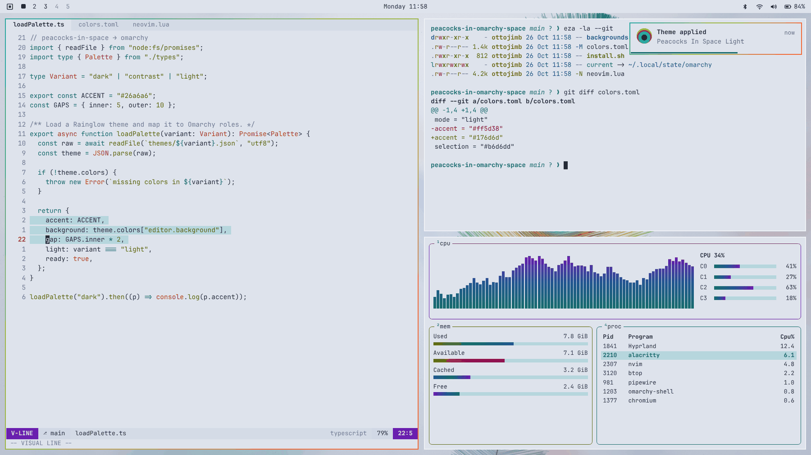

# Peacocks In Space Light for Omarchy

An Omarchy 4 theme adapted from Peacocks in Space by [Rainglow](https://github.com/rainglow/vscode).

Variants: [Peacocks In Space](https://github.com/ottojimb/omarchy-peacocks-in-space-theme) · [Peacocks In Space Contrast](https://github.com/ottojimb/omarchy-peacocks-in-space-contrast-theme) · **Peacocks In Space Light**



## Install

```bash
omarchy theme install https://github.com/ottojimb/omarchy-peacocks-in-space-light-theme
```

Omarchy skips Lua files, terminal configs and `vscode.json` in themes installed from git. You get
the palette, borders, wallpapers and a translucent bar, launcher and notifications, but not the
blur, the translucent terminal or Rainglow's syntax in Neovim. For all of it, install the three
variants from the [source repository](https://github.com/ottojimb/peacocks-in-omarchy-space) instead:

```bash
git clone https://github.com/ottojimb/peacocks-in-omarchy-space
cd peacocks-in-omarchy-space && ./install.sh
```

## What's included

- Peacock-feather gradient on window borders, carried to notifications, the launcher and the lock screen
- Eight-hue terminal palette built from Rainglow's accents
- Frosted glass: translucent terminal, bar, launcher, menus and notifications over a blurred wallpaper
- Three 4K wallpapers drawn from the palette: a peacock eye, a fanned plumage and a nebula

## Credits

Palette: Peacocks in Space by Dayle Rees, from Rainglow (MIT). This repository is generated
from [peacocks-in-omarchy-space](https://github.com/ottojimb/peacocks-in-omarchy-space); send changes there.
